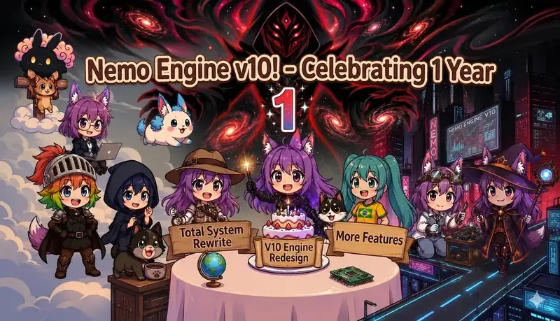

  

> **Nemo Engine v12.3:** [Download the updated preset](./Nemo_Engine_v12.3.json) with visual novel Vex commentary and the complete portrait catalog. The model emits compact named dialogue; bundled display-only regex adds portraits, expressions, and Next/Back arrows. [Renderer setup and sample](./assets/vex/renderer/README.md). The v12.1 guide below remains available for its documented editions.

> The v12.2 filenames are retained as legacy download aliases; Nemo Engine v12.3 is the current preset.

# Nemo Engine v12.1

**A modular Chat Completion preset for character roleplay, collaborative fiction, living worlds, and RPG-style scenes.**

Nemo Engine supplies the instructions, selectors, state formats, and rendering rules. Your connected language model writes the story. Vex is its configurable narrator lens, not a separate model or an NPC who automatically exists in the scene.

This guide documents the four v12.1 exports prepared for this release. It follows their actual prompt sections, including the newer Alpha craft modules, Interpreter, Mental Projection, planning delivery, and the full edition's two resolver systems. Historical v11 documentation is not an accurate list of v12.1 defaults.

> **Publication status:** the four v12.1 JSONs below have been prepared and inspected, but are not yet committed to this repository at this documentation update. The filenames are listed for identification, not presented as working download links. Existing older downloads are in [Archive](./Archive/). This README does not itself install or publish the presets.

[Choose an edition](#editions) · [Install and configure](#setup) · [Saved configurations](#profiles) · [Section guide](#sections) · [Starter configurations](#starters) · [Troubleshooting](#troubleshooting) · [Source and maintenance notes](#maintenance)

## Choose an edition

| Prepared filename | What it contains | Size |
| --- | --- | ---: |
| `Nemo Engine v12.1.json` | Standard edition; direct Vex, genre, influence, and format controls; ordinary prompt spaces | 3,288,357 bytes |
| `Nemo Engine v12.1 full.json` | Standard systems plus the Vex Council resolver and Genre × Author × Style recipe libraries; ordinary prompt spaces | 28,991,021 bytes |
| `Nemo Engine v12.1 [braile space].json` | Standard edition with Braille spacing restored in prompts and both context-conversion rules enabled | 3,679,617 bytes |
| `Nemo Engine v12.1 full [braile space].json` | Full edition with Braille spacing in prompt prose, recipes, and Vex text, plus both context-conversion rules enabled | 36,946,325 bytes |

The bracketed spelling `[braile space]` is intentional in the release filenames. Elsewhere this guide uses the conventional spelling, Braille.

The standard edition contains **569 prompt entries**. The full edition contains **786**, including library and infrastructure entries, not 786 settings that should all be enabled. All four exports contain **493 embedded regex scripts** and **two saved prompt-order profiles**.

Start with the standard, ordinary-space edition when you want the simpler configuration and easier text inspection. Choose full specifically for combined Vex selection and stored writing recipes. Full is not a separate difficulty level, more capable model, or instruction to send its entire file to the model.

### What the Braille option changes

The Braille editions use U+2800 Braille Pattern Blank in prompt prose and enable this adjacent regex pair:

1. `Nemo · Braille spaces 1/2 (CONTEXT ONLY; protect HTML/code)`
2. `Nemo · Braille spaces 2/2 (CONTEXT ONLY; cleanup; keep adjacent)`

The first converts eligible ordinary spaces in user/assistant context, with protection patterns for code and markup. The second cleans up protected spans. Keep their order and adjacency. The separate `Nemo · Display normalize Braille blanks to ordinary spaces` rule changes displayed assistant text back to ordinary spaces. It is enabled in all four editions and does not introduce Braille blanks.

Turning off the pair does **not** remove Braille characters already stored in preset prompts or old messages. Switching to the ordinary-space export handles the preset's prompt text; it does not rewrite your saved chat archive. These are whitespace variants, not documented guarantees of better writing, fewer tokens, or greater model compatibility.

## Install and configure

Import one complete JSON as a **Chat Completion preset** in SillyTavern. Select the imported preset, configure your model connection, and add the character card, persona, scenario, and lore material for the story. Keep a separate copy of your previous preset and save experiments under a new name.

[NemoPresetExt](https://github.com/NemoVonNirgend/NemoPresetExt) is the companion used to expose categories, headings, tooltips, and mutual-exclusion metadata. The preset stores these annotations in prompt comments. Without a compatible UI, you must manage the same prompt choices and order manually. A badge or tooltip is configuration guidance, not proof that every frontend enforces it.

**Do not paste the JSON into chat or import it as a character card.** Keep `prompts`, `prompt_order`, and `extensions.regex_scripts` together. After importing, confirm that the bundled regex layer is available and active in your installation. Missing rendering or cleanup cannot be repaired by simply adding more narration instructions.

### Configure the API before your first generation

These exports serialize `temperature: 2`, `top_p: 0.87`, `top_k: 491`, `openai_max_context: 2000000`, and `openai_max_tokens: 64000`. These are file settings, **not verified limits or recommendations for every model**. Set context, response budget, sampling, and reasoning controls to values supported by your actual endpoint before generating. A number in a preset does not enlarge a model's context window.

Streaming and `show_thoughts` are enabled in the files. Web search and function calling are disabled. Optional image-related prompts do not, by themselves, connect an image service. The serialized assistant-prefill field is a macro, `{{getvar::PlanningAssistantPrefill}}`; do not replace it with a permanent opening tag merely to make it look less empty.

### A practical configuration order

Choose the edition first. Then choose User Role, World Logic, Vex, the seven core craft layers, writing style, pacing, agency, difficulty, perspective, interiority, tense, and response length. Configure planning separately from delivery. Add state, trackers, and specialized content only after the basic story behaves correctly.

For each pick-one group, disable the old choice when enabling a new one. When changing a master switch, distinguish its dependent controls from independent systems. Save, start a small test scene, and inspect both the visible reply and the actual assembled prompt when something behaves unexpectedly.

### Understand the control types

| Type | How to use it |
| --- | --- |
| Pick-one selector | Choose one entry in that group: User Role, World Logic, each craft family, pacing, agency, difficulty, camera, tense, length, planning host, or delivery. Some have initialized fallbacks; explicit selection is easier to inspect. |
| Optional additive toggle | Enable only for a behavior you want. World augments and many utilities can combine, but conflicting requests remain conflicting. |
| Master and dependents | Mental Projection groups depend on its master; Pad Tabs depend on Scratchpad; draft styles depend on Draft in CoT and a planning host. |
| Initializer or resolver | Keep enabled in the supplied order. These reset slots, combine selected options, and emit the final instructions. They are not optional style packs. |
| Display/context regex | Determines what renders or what is sent back as context. A hidden panel may still be retained for the model. |

## The exports contain two saved configurations

The JSON has `prompt_order` entries for `character_id` **100000** and **100001**. They are not named user-facing presets here, and this guide does not assume which one your installation applies. Check the active prompt-manager selection. A prompt's own `enabled` field, its `@default-enabled` annotation, and its entry in a saved order can differ.

These are important differences in the supplied files, not new settings applied by this documentation:

| Setting | Order 100000 | Order 100001 |
| --- | --- | --- |
| User Role / World Logic / Agency / Difficulty | User is a Character / Anime / Collaborative / Balanced | Same |
| Seven craft families | Alpha selections | Alpha selections |
| Vex | Narrative Vex | Default: Vex |
| Camera / tense / length | Third Person Omniscient / Present / Long | Second Person / Present / Organic |
| Interiority | Visible | Visible |
| Pacing | No explicit pacing selector enabled | Literary Mode |
| Main planning host | Main Plan | Legacy: Council of Vex |
| Draft in CoT | Off | Off |
| Terminal outcome | The Epilogue | Return By Death |
| Retro Frame | Off | On |
| Embodied Salience / Dormant Threads / Beat Logic | On | Off |
| Standard direct writing | No explicit genre or format selection | Comedy + Light Novel |
| Full recipe selectors | Genre Auto / Author Auto / Style Auto | Comedy / Author Auto / Light Novel |
| Mental Projection master | Off, with component groups preselected | Same |
| Scratchpad | On, with no optional Pad Tabs selected | Same |
| Modern NSFW Core | On | On, with additional optional adult controls selected |

The full edition's all-Auto state is **Slice of Life / Nemo Manuscript Voice / Modern Literature**. In order 100001, Comedy supplies **Terry Pratchett** as its inherited author; Author Auto leaves that choice intact, and Light Novel overrides the style.

The enabled Exact Draft style in order 100000 is dormant because **Draft in CoT is off**. Conversely, turning off the old `Tracker Toggle` in order 100001 does not act as a universal tracker shutdown: in this version that entry is a compatibility placeholder, and selected tracker specifications use the automatic shared renderer.

# Section-by-section guide

The following sections follow the preset's organization. The full edition inserts additional initialization data and the recipe controls; it does not replace the rest of the engine.

## 1. Core: top-level controls

**Interpreter** is an optional accessibility layer for understanding intended meaning from context. It suppresses non-Mental-Projection misunderstanding hooks and adds an intake step to the selected planning method. It does not give characters information they never received, rewrite the user's authorship mode, or replace Mental Projection's own perception and interpretation rules. Enable it for language ambiguity or unwanted literal misunderstandings, rather than as a new world-knowledge source.

**Success Dice + Tactical Combat** selects an optional resolution protocol. Its top-level entry is a selector, not a roll. The automatic dice output uses a d100 branch for applicable non-TTRPG worlds. **Video Game: TTRPG instead activates its own d20/DC protocol even with Success Dice off.** Selecting both does not mean rolling d100 and d20 for the same attempt. The d20 protocol supplies twelve native roll-macro slots and permits an explicitly identified model-simulated fallback when valid inputs are unavailable. It is not a persistent audited random-number service.

**Narrative Progression** tracks Open, Call, Commit, Trials, Descent, Crisis, Climax, and Aftermath. It considers the plot, individual relationships, the current scene, time spent in a stage, stakes, and actual transition conditions. It is not a rule to escalate every reply or advance after a fixed number of turns. It uses the existing Scratchpad when available, otherwise accepted history.

**Swipe Correction** tells the model to recount a replacement from its accepted predecessor. A discarded draft or swipe must not become another lived turn. This is an instruction for model-maintained records, not a hidden counter mutation.

## 2. Variable Initialization

Keep the entire initialization sequence enabled. The standard edition resets meta directives, Vex slots, craft slots, planning and model-delivery slots, tracker/display state, languages, utility labels, prose conventions, ownership/interiority, consequence state, narrator/world/craft defaults, Scratchpad state, and Mental Projection routing.

The full edition also initializes Vex state/maps, routing metadata, profiles, and exchanges. Its writing libraries are conditionally loaded later, **after recipe selection**. Do not drag all library blocks to the beginning simply because their names contain `Init`.

These variables mostly compile instructions for a request. They are not automatically the story's long-term memory. Disabling resets can leave stale selections; disabling resolvers can leave a visible checkbox with no assembled output.

## 3. User Role Modes

Choose exactly one authorship relationship:

| Mode | What it means |
| --- | --- |
| **User is a Character** | The human controls an in-world player character. Nemo authors the surrounding world and eligible characters within the active ownership rules. |
| **Cowriter Frame** | The human is an external equal-footing coauthor; unmarked prose enters canon rather than being treated as a player's attempted action. |
| **Anime Cowriter Frame** | The same coauthor relationship with an unseen anime-narrator continuation lens. |
| **Director Mode** | The user character stays in-world but becomes fully authored by Nemo. |
| **User as Director** | The human is outside the fiction and supplies external story direction rather than inhabiting a player character. |

**Director Mode and User as Director are different.** Camera choice does not substitute for either one. Writing in second person does not grant permission to invent a human-controlled character's voluntary decisions.

The optional **Hard User Autonomy** modifiers apply to User is a Character. Choose at most one. Plain Hard User Autonomy reserves unsupplied voluntary behavior to the human. **Resolved Input** additionally treats the user's contribution as already committed to the extent written and continues from its impact or aftermath instead of replaying it as an unmade decision. Keep the Hard User Autonomy Resolver enabled.

## 4. World Logic and Archetype Modifiers

World Logic defines the operating conventions of the world, not merely its prose style. Choose one: **Literary, Grounded, Realism, Genre Logic, Video Game, Anime, Hentai, Video Game: LitRPG, or Video Game: TTRPG**.

Literary prioritizes literary-fiction conventions and psychological complexity. Grounded uses material constraints without genre shortcuts. Realism broadens attention to survival, injuries, logistics, and social consequences. Genre Logic follows the established genre's conventions. Video Game introduces game-like systems; LitRPG emphasizes progression; TTRPG uses the dedicated tabletop-style resolution branch. Anime uses anime/manga conventions. Hentai is a specialized adult world lens, not a general-purpose requirement.

Genre and World Logic are separate. A Romance writing recipe can operate in a Grounded world; Horror does not automatically select maximum difficulty.

The optional **Archetypes Engines** are Literary, Grounded, Realism, Genre, Video Game, and Anime. Select at most one and normally pair it with the corresponding World Logic. They supply classification references and analysis procedures, not newly established character facts. Keep the Archetype Framing and World Definition resolvers enabled.

## 5. World Augments

These are additive world behaviors. Select a small, coherent set rather than treating every augment as a quality upgrade.

**Living World** contains three distinct controls: **Embodied Salience** makes perception responsive to the body and circumstances; **Dormant Threads / Offscreen Motion** keeps established offscreen activity consequential; **Beat Logic / Scene Turn Discipline** gives actions and responses causal, role-correct turns. They are not aliases for Narrative Progression or the Parallel Storylines utility.

Environment controls include **Bustling Environment, Environmental Descriptions, Physiological & Environmental Realism,** and **Everything is Alive!** The last is a specific altered-world premise, not simply richer description. The Environment & Attention Resolver combines overlapping selected environment/attention modules.

Other altered premises include **Aura of Emotions, Dreamscape Reality, The Honesty Plague, Prophecy Magnet, Foreigner <user>, Gynocentric Society,** and **Anime Erotica Calibration**. These can materially change the setting. The Honesty compatibility resolver adapts deception-dependent modules; its presence does not mean everyone gains mind-reading or is compelled to disclose every private fact.

Plot/world pressures include **Slow Burn Mysteries, Ambient Monster Threat,** and **Dungeon Delve Focus**. Realism augments separately cover **Consequences, Social & Consequence Realism, Violence Realism, Logistical & Survival Realism, Grounded Realism & Gritty Detail, Harsh Realism, Realism Overall, Manipulation Realism,** and **Psychological Erosion**. The latter is explicitly a harsh fictional lens, not a clinical account of real people. **Intimate Scene Interruptions** is a specialized scene module, not a general randomness engine.

**Vampire the Masquerade** and its **Alt** version are a pick-one setting pair. **Blood Bond Mechanics** is a separate, substantial setting-specific module. Use these for the appropriate fiction rather than general character depth. Inspect the actual outgoing token count when adding large optional modules.

## 6. Vex Personality

### Standard edition: select one narrator lens

Choose **Default: Vex** or one named personality. Each sets the narrator lens and planning register. Vex does not override ownership, factual continuity, character knowledge, or the selected world rules.

Available personalities are **Brooding, Bubbly, Chaotic, Clinical, Cozy, Crescent, Dark Urban Fantasy, Epic, Explosive, Gamemaster, Gentle, Grimdark, Haar, Lustful, Morbid, Narrative, Noir, Obsessive, Petrichor, Philosophical, Sensory, Shadowy, Soft Romance, Tactical, Tsundere, Underdog, Unhinged, Whimsical, Goon Gremlin, Gooner,** and **Midnight Courier**. The embedded profiles describe their particular voices; they are not difficulty presets.

### Full edition: select a set of Vexes

Full replaces the standard single-selection behavior with a family resolver. One selected member of a family remains that individual. Two or more selected members from that family consolidate into its master Vex. Resolved families can then coexist, and independent Vexes append separately. Keep both resolution stages, the routing initialization, and the text libraries enabled before the Premise.

| Family | Members |
| --- | --- |
| **Darkness** | Brooding, Dark Urban Fantasy, Grimdark, Morbid, Noir, Shadowy |
| **Happy** | Bubbly, Cozy, Gentle, Petrichor, Soft Romance, Whimsical |
| **Havoc** | Chaotic, Explosive, Unhinged |
| **Precision** | Clinical, Crescent, Haar, Tactical |
| **Adventure** | Epic, Gamemaster, Underdog |
| **Desire** | Lustful, Goon Gremlin |

**Narrative, Philosophical, Sensory, Obsessive, Tsundere, and Gooner** are independent. **Midnight Courier** is an additional legacy independent profile and does not enter the six-family key. In full, **Default: Vex** is a fallback when no family or independent personality is selected, not a forced competitor to every active council.

For example, **Brooding + Noir + Sensory** produces the Darkness family lens plus independent Sensory Vex. **Tactical alone** stays Tactical rather than becoming Precision. This is preset-side selection/assembly, not multiple API calls to separately running Vex agents.

**Vex Commentary** requests visible comments rendered from `<vexnote>` markers. **Vex Meta-Commentary** frames configuration through the selected Vex's voice inside instructions; it is not the same visible chat feature. The **Legacy: Council of Vex planning mode** is also separate from full's narrator-family resolver.

## 7. Core Prompts: Premise, frames, and seven craft layers

Keep **The Premise** and **Core Assembler** enabled. The Premise brings together identity, active User Role, resolved World Logic, Narrative Progression, Vex material, and core laws. **Retro Frame: NemoNet Bootup** and **Magpie Frame** are optional framing layers; neither installs a service or replaces the base engine.

Each craft family is independently configurable. Choose one option per family; you do not need to choose the same family label across all seven. The inspected profiles select Alpha throughout.

| Craft section | Purpose | Choices |
| --- | --- | --- |
| **Narration** | Authorial voice, detail, rhythm, and how experience reaches the page | Default; Alpha: Author Voice; Omega; Understated |
| **Speech** | Character-specific dialogue, listener relationship, register, and delivery | Default: Adaptive Dialogue; Alpha: Relational Voice; Omega: Heightened Character Dialogue; Theta: Stylized Genre Dialogue |
| **Character** | Private logic, self-image, outward behavior, motives, and individuality | Default; Alpha: Private Logic; Omega |
| **Development** | Change through accumulated experience and persistent consequences | Default; Alpha: Accumulated Experience; Omega; Theta |
| **Grounding** | Proportional, scene-owned tone and practical/material life | Default; Alpha: Lived Tone; Omega; Theta |
| **Knowledge** | Fact versus interpretation, expertise, provenance, and information barriers | Default; Alpha: Fact and Interpretation; Omega; Theta: Legacy |
| **Narrative** | Experienced causality, scene activity, progression, and stopping points | Default; Alpha: Experienced Causality; Omega; Theta |

Alpha is a particular rebuilt craft approach, not universally the strongest intensity. Omega emphasizes its own more heightened or strongly structured treatment, while the available Theta/legacy variants retain different older approaches. Read the individual descriptions before mixing.

The **Speech: Emphasis Controls** resolver coordinates dialogue emphasis with selected craft and utilities. **More Dialogue** is a separate control, not another Speech family. Do not enable every speech variant to ask for a richer voice.

Nemo's rule markers distinguish internal laws, boundaries, procedures, directives, defaults, style, lenses, flexibility, and examples. Higher-level authorship and knowledge boundaries are not canceled by a stylistic preference or an example. This is the preset's internal instruction vocabulary, not a change to the provider's actual instruction hierarchy.

## 8. Magpie Files

**Character Files** are tiered dossiers for Mooks, Side characters, and Main characters, including explicit reclassification when an earlier assessment was wrong. **Location Files** describe recurring or consequential places. **Important Object Files** cover items with information, provenance, access, power, risk, or recurring consequences.

Select the types you want. Their markers are rendered into inline/hover displays by the bundled regex layer. These are model-written story records, not actual files automatically saved into your operating system or lorebook. They can coexist with Scratchpad and Mental Projection, but should not create contradictory copies of the same fact.

## 9. Consequence

Keep **Consequence Core** and choose one terminal-outcome route. Difficulty determines whether and how a terminal outcome can occur; Consequence determines what follows for the subject defined by the active User Role.

| Outcome | What follows |
| --- | --- |
| **Somewhere Else** | The subject goes to another world; the previous story is left unfinished. |
| **Return By Death** | A prior checkpoint is restored, with memory retained only by the applicable subject. |
| **Roll Another** | Death stands; a replacement focal character continues in the same world. |
| **The Epilogue** | The story ends and its aftermath is followed. |
| **Never The Kill** | Death is unavailable to the subject, although survivable consequences can remain severe. |
| **Director's Chair** | The human directs the remaining story after the subject's death. |
| **Still Here** | The subject remains as a setting-bound ghost. |

Do not stack endings. **IronMan + Return By Death** does not mean ignoring one toggle: one governs fatal pressure, the other the selected aftermath. The relevant character is role-dependent; an external coauthor is not automatically an in-world death target.

## 10. Language Control

Planning and narration have separate language selectors. Choose one **Plan** language and one **Narrate** language from **English, Chinese, Russian, Japanese, Korean, Portuguese, Spanish, Thai, Romanian, Ukrainian, French,** or **Arabic**. Both saved orders use English for both.

Keep **Language Runtime Resolver** and **Language Styling** in place. The former combines the selected language state; the latter supplies the associated presentation instructions. English-language prompt scaffolding is not a reason to change the selected output language. These settings request language behavior; they do not prove a particular model's fluency.

## 11. Classic Helpers & Modes

This legacy section is present in order 100000 but omitted as a section from order 100001, which retains only some legacy entries elsewhere. It contains **Classic Vex Identity, Vex's Director's Cut, Classic Mode: Single Lens, Classic Mode: Council**, and credited helpers from **Brazilian Friend, Forsaken_Ghost_13, Interiority Protocol, Nemo's Experimental,** and **NokiaArmour**.

These are compatibility/alternative instruction bundles, not prerequisites for modern Alpha craft, the full Vex resolver, or Mental Projection. Keep incompatible single-lens/council choices exclusive. Use a named helper deliberately after reading it; stacking all legacy helpers can reintroduce a different instruction style. Legacy planning hosts are selected in Planning, not by assuming that any option with Council in its name replaces the current host.

## 12. Genre, influences, and formats

### Standard edition: direct writing modifiers

The standard Genre section contains **Angst, AO3 Style, Comedy, Dead Dove, Erotica, Fluff, High Fantasy, HTML Reality, Medieval, Melancholy, Romance, Slice of Life, Texting Format, Thriller,** and **Tragedy**. They add the supplied genre instructions directly. They do not invoke the full edition's stored recipe grid.

Influences are grouped for navigation into **Action & Adventure Authors, Horror & Psychological Authors, Comedy & Satire Authors, Literary Fiction Authors, Romance & Emotional Authors, Fantasy & Mythology, Regional Styles,** and **Utility Styles**. These headings are shelves, not independent world switches.

The named influence set includes Jin Yong, Gu Long, Kamachi Kazuma, Masashi Kishimoto, Quentin Tarantino, Chuck Palahniuk, Fyodor Dostoevsky, Akira (Denpa Style), Stephen King, Douglas Adams, Terry Pratchett, Yasunari Kawabata, Haruki Murakami, García Márquez, Salman Rushdie, Lu Xun, Wang Xiaobo, Li Bihua, Cormac McCarthy, Ernest Hemingway, Jun Maeda / Key, Nisio Isin, Jane Austen, Brandon Sanderson, and Neil Gaiman. These are the preset's craft profiles, not newly researched claims about the authors.

Additional influences include **Arabian Nights, Medieval Setting, Japanese Literature, Chinese Literature, Indian Literature, Middle Eastern Literature, Latin American Literature, German-Language Literature, Scandinavian Literature, Japanese Honorifics, Regional Dialect, Cyberpunk Noir, Nemo Writing, Gritty Prose,** and **VtM Narration**. Use regional and language traditions as the supplied writing choices, not as universal descriptions of populations.

The direct Formats are **AO3 Style, Erotica, Light Novel, Web Novel, Roleplay Format, Modern Literature, Classical Literature, Epic Saga / Edda, Stage Play,** and **Stream of Consciousness**. Start with one coherent genre/influence/format combination. Multiple additive instructions do not automatically become a carefully resolved hybrid. Prose Convention, camera, User Role, and World Logic remain separate controls.

### Full edition: Genre × Author × Style recipes

Full adds **17 genres × 27 author profiles × 28 styles = 12,852 stored combinations**. Select one entry in each of **Genre Selection, Author Selection,** and **Style Selection**. Auto is an inheritance choice, not another catalog axis or a model-driven recommendation engine.

The sequence matters: **defaults → genre → author → style → index/guard → selected-genre library → selected combination**. Genre can set a default author and style. An explicit author can override inherited values; a final explicit style overrides the style. Author Auto and Style Auto leave the inherited values unchanged.

**Worked configuration:** select **Genre: Comedy**, **Author: Auto**, and **Style: Light Novel**. Comedy selects the Pratchett author profile, Auto keeps it, and Light Novel replaces the inherited Modern Literature style. The result is the stored **Comedy / Terry Pratchett / Light Novel** recipe. Select an explicit author to change that middle component.

The genre catalog is **Action / Adventure, Character Drama, Comedy, Crime, Cyberpunk Noir, Erotica, Fantasy, High Fantasy, Historical Fiction, Horror, Mystery, Progression Fantasy, Romance, Science Fiction, Slice of Life, Thriller,** and **Tragedy**.

The 27 author profiles are **Akira (identity unresolved), Brandon Sanderson, Chuck Palahniuk, Cormac McCarthy, Douglas Adams, Ernest Hemingway, Fyodor Dostoevsky, García Márquez, Gu Long, Haruki Murakami, Jane Austen, Jin Yong, Jun Maeda, Kamachi Kazuma, Li Bihua, Lu Xun, Masashi Kishimoto, Neil Gaiman, Nemo / Manuscript Voice, Nisio Isin, No Named Influence, Quentin Tarantino, Salman Rushdie, Stephen King, Terry Pratchett, Wang Xiaobo,** and **Yasunari Kawabata**. The unresolved Akira attribution is retained explicitly rather than silently assigned to a particular creator. **No Named Influence** is an explicit recipe profile; it is not the same as Auto.

The 28 style choices are **Angsty / Emotionally Turbulent; Chat Roleplay; Chinese Literary Traditions; Compressed Gritty Prose; Epistolary / Documents; Fluffy / Comforting; Formal Literary Novel; Framed Oral Storytelling (Arabian Nights-inspired); German-Language Literary Traditions; Gothic-Punk; Indian Literary Traditions; Japanese Literary Traditions; Latin American Literary Traditions; Light Novel; Lyrical Prose; Melancholic / Reflective; Middle Eastern Literary Traditions; Minimalist Prose; Modern Literature / Contemporary Novel; Relationship-Centric Fanfiction (AO3-inspired); Saga / Oral Epic; Scandinavian Literary Traditions; Screenplay; Stage Play; Stream of Consciousness; Text Messages / Chat Transcript; Visual Novel;** and **Web Serial**.

Keep **Recipe Selection: Defaults, Writing Recipe Index, Selection Guard, all partitioned library entries,** and **Writing Recipe: Selected Combination** enabled in their supplied order. Library entries are conditional storage: their enabled checkboxes do not mean that thousands of recipes should appear in the outgoing prompt. The final getter selects one stored value. Frontend parsing and library handling still cost local work, so inspect the assembled prompt rather than estimating runtime tokens from download size.

### Full edition: Additional Writing Modifiers

The older direct genre, influence, and format controls remain under **Additional Writing Modifiers**. They add independent instructions; they do not change `NCGenreId`, `NCAuthorId`, or `NCStyleId` for the recipe selector. Start with these off and add a specific extra modifier only when needed. Selecting direct Comedy is not a substitute for **Genre: Comedy** in full.

## 13. Plot Pacing

Choose one explicit pacing mode when you want to fix the tempo:

| Mode | Emphasis |
| --- | --- |
| **Literary Mode** | Contemplation, scene texture, and room for moments to develop |
| **Narrative Pressure** | Escalation, complication, payoff, or reframing without seizing user agency |
| **Active Mode** | Kinetic scenes, tighter transitions, clear consequences |
| **Slow Burn** | Incremental pressure and delayed, earned release |
| **Sandbox Mode** | Exploration, route freedom, available hooks, and consequences |
| **Episodic Mode** | Local arcs with continuity between episodes |

Pacing is not response length. A short reply can sustain Slow Burn; a long reply can describe one immediate action. Narrative Progression tracks where the story stands, while Pacing shapes how the current interval unfolds.

## 14. Story Agency

Select **User-Driven**, **Collaborative**, or **AI-Driven**. This controls initiative over the direction of the story. User-Driven follows the human's lead; Collaborative shares story momentum; AI-Driven gives the engine more initiative over events and hooks.

Agency does not silently change ownership. AI-Driven with User is a Character still has a human-controlled player. To ask Nemo to author that person's voluntary behavior, choose the appropriate User Role rather than relying on an agency label.

## 15. Utility

Utility contains several different types of configuration. Its subsections are not interchangeable master switches.

### Formatting & Interface

**Scene Header (Time/Location/Weather)** requests scene orientation. **Machinery Display: Visible** and **Machinery Display: Hidden** are a pick-one display preference for generated machinery. Hiding a display is not deleting raw state or guaranteed token reduction.

**Auto Image Gen** supplies an image-oriented prompt behavior; an actual image connection is a separate requirement. **Immersive World HTML [V6 Hybrid]** requests richer rendered in-world objects/interfaces. Neither this nor HTML Reality means the frontend can execute arbitrary application functionality. **Utility: Color Formatting (v6)** supports colored presentation; keep its infrastructure intact when using the associated formatting.

### Prose Convention

Choose exactly one convention: **RP Markdown, Literary, Simple,** or **Continental**. RP Markdown uses quoted dialogue and backtick thoughts with its roleplay conventions. Literary uses book-like unmarked narration and reserves italics for thought. Simple requests plain text with quoted dialogue and no decorative emphasis syntax. Continental requests dash-led dialogue instead of quotation marks.

Keep **Prose Convention Resolver** enabled after style/influence selection. The separate legacy **RP Markdown** utility has its own markup instructions and is not required just because the convention is RP Markdown. Avoid enabling competing formatting instructions and expecting every style's punctuation to win simultaneously.

### Response Discipline

**Anti Echo / User Agency** is the older role-aware anti-echo nudge. **De-Hedge Response Discipline** discourages stalling and treating permissive wording as an excuse not to respond. **Danger Protocol** permits credible physical consequences through character, opportunity, and fictional time; it is not an artificial two-reply danger countdown. **Anti Horny** suppresses unsolicited sexualization and escalation while retaining ordinary warmth and romance. Its tooltip specifically calls for turning off NSFW modules when using it.

These utilities are separate from the later Anti Prompts section. Use the smallest set that targets the actual behavior you dislike.

### Character & Dialogue

**Character Naming** asks for varied, fitting names. **Proactive Characters** gives NPCs independent goals and actions. **Proactive Dialogue / Engaging NPCs** prevents passive question-answer exchanges. **NPC Spotlight** gives a supporting character an occasional close limited-POV beat without abandoning the live scene.

**Character Friction** supports refusal, skepticism, boundaries, and independently motivated conduct. It is not a command for everyone to obstruct everything. **Anti Robot / Natural Characters** targets robotic presentation and behavior. **More Dialogue** increases dialogue emphasis but does not replace the Speech family.

### Style, Format & Extras

**Swipe Enhancer** seeks variety in regenerations. **RP Markdown** is the older explicit markup module. **Manga Side Character Intro** supplies compact introductions. **Literary Chameleon** deliberately changes author style between responses; leave it off when you want a stable full-edition author recipe.

**Parallel Storylines** manages other narrative threads and cutaways. It is distinct from the optional Scratchpad tab that displays their state. **Decentered Protagonist** reduces automatic narrative centrality. **Anti-Chekhov's Gun** allows details to exist without demanding a later payoff. A separate **Utility OOC Resolver** gathers selected utility instructions into one block; keep it enabled instead of manually copying each utility into another prompt.

### Difficulty

Choose **Balanced, Cozy, Hard Gritty, Heroic, IronMan, Nightmare, Story Mode,** or **God Mode**. Balanced aims for fair complications; Cozy is gentler; Hard Gritty removes easy protection; Heroic provides heroic latitude; IronMan and Nightmare are harsher; Story Mode and God Mode provide progressively stronger power-fantasy framing.

Read these as authored world-pressure instructions, not a deterministic game difficulty setting. They do not change model intelligence. Check Difficulty together with Consequence when outcomes feel too soft or too punishing, and remember that a genre lens does not itself select difficulty.

### Perspective, Interiority & Tense

Choose one camera: **First Person, Second Person, Third Person Limited,** or **Third Person Omniscient**. It determines narrator ownership, focal identity, and access. It does not grant characters the narrator's knowledge or overwrite User Role.

Choose **Visible interiority** or **Hidden interiority**. **Both require actual eligible character thoughts.** Hidden wraps private prose for display-only removal; it does not mean no interiority, no raw text, or zero context cost. Character-owned inner speech is fictional content, distinct from the model's own planning. Keep **Narrator & Craft Resolver** enabled.

Choose one tense: **Past, Present,** or **Future**. Keep it independent from perspective and author influence.

### Response Length

Choose **Short, Medium, Long,** or **Organic**. These shape response scope. Organic lets the current scene determine length; it is not a guarantee of brevity. API output limits still apply and can cut off trackers or a workbench before their closing markers.

### Mental Projection

The **Mental Projection** master activates character-level mental state and continuity. Component groups being preselected does not activate MP while its master is off. Keep the automatic routing, state-contract, and integration entries enabled.

| Group | What it contributes |
| --- | --- |
| **MP 01: Body & Neurochemistry** | Bodily condition and neurochemical-inspired state channels |
| **MP 02: Needs & Appraisals** | Needs and how this character interprets what happens |
| **MP 03: Affect & Cognition** | Emotional and cognitive condition |
| **MP 04: Memory & Learning** | Character-owned memory and learning rules |
| **MP 05: Motivation, Choice & Friction** | Desires, willingness, aversion, cost, opportunities, and choice |
| **MP 06: Relationships & Social Behaviour** | Interpersonal state and social expression |
| **MP 07: Conscious Workspace** | The fictional character's consciously present thought and attempts to work with it |
| **MP 08: Neural Pathway Map** | A visualization of the active state and its supported connections |
| **MP 09: Embodied Narration & Speech** | How the character's state affects expression |
| **MP 10: World Context & Resolution Bridge** | Connection to genre, world rules, stakes, and the single selected outcome protocol |

MP is an authored fiction simulation. Its neurochemical names are dimensionless inspired channels, **not measured concentrations, diagnoses, or a clinical model**. The map summarizes state rather than driving it.

State lives in model-written `<mental_state>` text. It is inherited by stable character identity and accepted timeline, not stored in a hidden database. Setup variables choose instructions and placement. Missing or inactive fields are not zero; disabling a group makes its carried values inert rather than instructing the model to erase the character's history.

MP tracks only eligible in-world minds. The external human and Vex personas do not become psychological subjects simply because their names appear in the prompt. User Role determines whether a fully authored user character is eligible.

For planning integration, either choose **Mental Projection Plan** as the sole host, or keep another host and enable **Plan: Mental Projection Compatibility**. The dedicated MP host already includes its integration and does not need a second adapter pass. A map warning or pending tracker display does not mean the renderer has repaired the underlying state.

### Scratchpad

**Scratchpad** is the master switch. With no optional Pad Tabs selected, it uses the complete legacy HTML pad. With one or more tabs selected, it switches to the modular core plus exactly those selected tabs. Turning the master off disables both layouts and all Pad Tab output.

Available tabs are **Consequence, Parallel Storylines, Next Cutaway, Canon, Narrative Stage, Affinity, Stats, Inventory, User Preferences,** and **Turn Carry**. Choose records useful to the story. A tab is an output selection, not a substitute for the underlying feature or proof that a numerical system exists.

Use Canon for established facts, Turn Carry for unresolved continuity into the next interval, and the other named tabs for their corresponding state. Narrative Stage can display progression state without adding another lived turn. A Scratchpad is not the same as the planning workbench, and offscreen fiction inside it must not be casually discarded as private planning.

### Trackers: select content, renderer, and theme separately

Enable the tracker you need, choose one shared render mode, and optionally select one theme. The old **Tracker Toggle** contains no active dispatch logic in this export; the automatic renderer responds to enabled tracker specifications. Turn off the relevant specification to stop that tracker.

| Renderer | Output requested from the model |
| --- | --- |
| **HTML/CSS Render** | Model-designed raw HTML/CSS, with standalone blocks correctly marker-wrapped |
| **ASCII Render** | Text and box-drawing presentation |
| **Regex Render** | Compact semantic tags that the bundled regex turns into the visible interface |

Themes are **Light, Parchment, Sci-Fi, Terminal, Cell Phone, Noir Casefile, Occult Grimoire, Tactical HUD, Newsprint, Cyberpunk AR, Dossier,** and **Visual Novel**. No selected theme leaves the default presentation. Theme controls do not create a game system or force every unrelated interface to use the same renderer.

Tracker functions:

| Tracker | Purpose |
| --- | --- |
| **RPG Dashboard** | Character sheet: attributes, skills, equipment, inventory, conditions, currency |
| **CYOA** | Two to five immediate-action options plus Other |
| **CYOA: 3 Paths** | Exactly three materially different narrative routes; select instead of classic CYOA |
| **Dating Sim Interface** | AP/DP/TP relationship presentation, learned information, milestones, rival context |
| **Fandom Reaction** | Fictional audience responses with a specified viewing basis, not actual outside readers |
| **Gacha System** | Supplied fictional currencies, banners, pity, and reward timing rules |
| **Game Mechanic Tracker** | Custom meters for an established system |
| **Social Web** | Evidence-based character relationships and connection strength |
| **Karma / Cosmic Ledger** | Consequences under a declared judging code and evidence basis |
| **Quest Journal** | Active, completed, and failed objectives, progress, and rewards |
| **Scroll News Lore** | Setting-appropriate fictional communications and news |
| **Scene Dashboard** | Scene location, time, weather, and cast status |
| **Status Board** | Cast-state display using defined metrics or qualitative evidence |
| **Location Board / ASCII Minimap** | Spatial layout, zones, distances, exits, and positions |
| **Char's Knowledge Log** | Character-held knowledge, its sources, confidence, and revisions |
| **Vex Planning Quarters** | A spoiler-light story notebook with prerequisites and lifecycle, not a second planning host |
| **Manga / Comic Panels** | Panel-based presentation handled by the panel-sequence resolver |
| **Vertical Webtoon Panels** | Vertical panel presentation with its own coverage and trigger |
| **Dynamic World Anvil** | Compact OOC record of newly introduced lore |

Use one CYOA variant. A renderer cannot invent missing state, and activating several dashboards can duplicate information. Regex Render can avoid asking the model to write extensive tracker HTML, but the actual token difference depends on the generated content. Keep the schema and rendering rules paired.

## 16. Anti Prompts

These are independent targeted constraints: **Anti-Slop, Anti-Echo, Anti-Impersonation, Anti-Robot, Anti-Deification, Anti-Purple Prose, Anti-Repetition, Anti-Slop Names, Anti-Plot Twist, Anti-Summarizing, Anti-Mind Reading, Anti-Perfect Dialogue, Anti-Telling, Anti-Pattern,** and **Anti-Lazy Construction**.

Use the name and its embedded description to target an observed failure. For example, unwanted user-character authorship calls for checking User Role first, then the relevant impersonation constraint; overpolished interchangeable dialogue suggests Speech selection and Anti-Perfect Dialogue; recycled sentence patterns suggest Anti-Repetition or Anti-Pattern. Anti-Plot Twist is not a generic writing improvement when deliberate twists are part of the premise.

Some older Utility controls have similar names. Do not mistake them for synchronized aliases. More constraints are not automatically a better configuration, and optional anti-style controls still sit alongside deliberate author/genre choices.

## 17. Databank

**Databank: Unified Card Context** packages the role-aware user context, scenario, main character material, supplied summary, and optional memory inputs. Keep it enabled when using this unified context path. Check the final assembled request before also enabling native card/persona/example blocks that could duplicate the same material.

`short_term_memory`, `long_term_memory`, and `NemoLore` are optional **external transport inputs**. Their presence as macro names is not proof of a connected memory provider. Empty or unexpanded values are unavailable inputs; the engine should continue from supplied history and records rather than pretend to retrieve something.

**NemoNet Search is fictional world-detail invention, not web browsing, RAG, or a substitute for failed memory transport.** Do not use it to claim that an absent lorebook or memory service was consulted.

## 18. Planning

Planning has four independent decisions: **host, optional steps, delivery, and drafting**. Do not select multiple hosts to obtain more thoroughness.

### Choose one host

| Host | Intended shape |
| --- | --- |
| **Fast Plan** | Compact operational decisions for rapid replies |
| **Loose Plan** | Selective planning led by the strongest scene signal |
| **Main Plan** | A thorough general-purpose scene plan |
| **Experimental Plan** | More complex scene architecture and stress-testing |
| **Council Plan** | Compact candidate selection, not a staged debate transcript |
| **Mental Projection Plan** | State-first planning using the active MP groups and inherited tracker; MP master required |
| **Legacy: Council of Vex** | Retained legacy council-style host |
| **Legacy: Fast Council** | Retained compact legacy council host |
| **Legacy: Explicit Thinking** | Retained legacy explicit-planning host |

Modern and legacy hosts share the same exclusive Planning Mode group. **Legacy: Selected Planning Entry Cue** is an optional cue, not another host. Full's Vex-family resolver and these planning hosts have separate jobs.

### Add only the planning steps you need

Information steps include **Knowledge Map, Information Asymmetry,** and **NemoNet Search**. Reflection steps include **Last Turn Critique** and **Course Correction**. State/scene steps include **Character State, In-Scene Character Turn Simulation, Pacing Beats, Narrative Hook, Emotional Matrix,** and **Physical Grounding**. Voice/relationship steps include **Voice Crafting, Subtext Layer,** and **Relationship Stage**. Interface steps include **HTML Design** and **HTML Marker Check**. **NSFW Focus** is specialized optional scene planning, and **Mental Projection Compatibility** is the master-gated adapter described above.

These are components within a selected host, not separate model calls. Keep the automatic combination helpers enabled so related steps can share one authoritative snapshot instead of duplicating state or checking the same event twice. A Narrative Hook selection should not be confused with authority to force a human choice.

### Choose one delivery mode

**Auto (known prefill blockers)** uses a finite built-in model-ID mapping. For recognized blockers it suppresses assistant prefill and delivers the selected planning body as an ordinary-output workbench. Unknown or conditional IDs keep the regular path. It does not discover arbitrary endpoint capabilities.

**Regular** forces the preset's regular planning/prefill/publication path. **Visible Workbench** forces the selected method into a saved, ordinary-output workbench. Neither changes which host is selected. **Auto: Also adapt summarized reasoning** expands Auto's handling for its finite summary-output list; it is not proof that every model exposing summaries rejects prefill.

Model names and endpoint behavior can change. The map is the data bundled with this export, not a promise about all current or future services. When Auto does not fit an endpoint, test an explicit delivery setting and inspect the request rather than enabling multiple delivery options.

### Drafting and Anti-Ramble

**Draft in CoT off:** plan/check, then write the reply once. A saved draft-style selection remains dormant.

**Draft in CoT on:** requests a full-response drafting workflow inside the selected plan. Optionally choose **Exact Draft + Vex Attack** or **Magpie Workbench** as the draft style. They are mutually exclusive. Exact Draft adds its draft, focused review/repair, and publication instructions; Magpie supplies READ → BEAT → DRAFT → ATTACK → SHAPE after the selected plan. These can substantially lengthen generated output. The option is not needed merely to obtain character thoughts.

**Anti-Ramble** discourages repeated reconsideration, verification loops, shadow drafts, and restarts. It does not replace the drafting switch or set a provider's hidden reasoning budget.

## 19. Core Assembly

Keep the Core Assembly section and its automatic components enabled in order. They gather selected craft, narrator, utility, state/output, and planning configuration. This is where toggles become assembled instructions. The assembler does not make a disabled optional feature active merely because its variable slot exists.

Do not move the Premise ahead of the role/world/Vex setters it reads, or move the planning delivery helper ahead of the host it resolves. Avoid editing identifiers, macro keys, shared variable names, or table keys while changing a prose preference.

## 20. NSFW · Sys Break

The **Sys Break** header contains a nonempty assistant-role boundary and is not just a decorative divider. The following **Optional Content: Deferred Selections** entry emits already-selected material. Keep these structural entries in their supplied positions even when individual adult-content toggles are off.

This layout separates selected optional material from the preceding assembly. It does not itself turn on a feature, change the frontend's Use system prompt setting, remove material from all other sources, or guarantee an endpoint's acceptance of content.

The content controls include modern **NSFW Core** and older/specialized options for **Dirty Talk, Dom Language, Moans SFX, Porn Tropes, Proactive Partners, Realistic Smut, Sexual Physiology, Hentai Mode, Dead Dove (Classic), NSFW Core (Classic),** and the named **Gooner** variants. They are distinct creative instructions with different assumptions, not a required stack. Order 100001 also contains **Subjective Proportions & Body Mechanics (Sena)**.

For nonsexual fiction, disable the applicable adult selectors across **World Logic, World Augments, direct/recipe Genre and Format, Planning's NSFW Focus, this section, Fetish, and Content Permissions**. Turning off only NSFW Core does not neutralize another independently selected adult-world or writing profile. Do not remove structural resolvers to achieve this.

## 21. Fetish and Content Permissions

The Fetish section contains specialized optional adult-fiction themes, including the named **CBT, Femdom, Feminization, Foot Fetish, Furry, Harem, Netori, NonCon, NTR, Petplay, Dating Sim (Quantum), Corruption (Fefnik), Forced Fem (Classic),** and **Harmonized HTML Enable (fefnik)** entries. This guide identifies their placement without expanding their explicit instructions. They are not general-purpose writing-quality modules.

**Consent: User, Consent: Acknowledged,** and **Extreme Content** are separate content-framing selectors. They do not select the engine's User Role, give a provider new capabilities, or demonstrate another participant's real-world consent. Review them before using an imported configuration; some are enabled in order 100001. A setting's presence in the catalog is not a requirement to enable it.

## 22. System

Keep the **Current Message Separator, Assistant Sudo Prefill,** and **User Message Ender** in the supplied order. They mark the latest contribution, carry the selected instruction reminder/plan, and hand control into the response under the active authorship rules. The assistant-role entry named Sudo Prefill is a preset prompt entry; do not conflate it with a guarantee that your provider supports an API assistant prefill.

The native **Main Prompt, Auxiliary Prompt, Chat Examples, Post-History Instructions, Chat History, World Info before/after, Enhance Definitions, Character Description, Character Personality, Scenario,** and **Persona Description** entries remain part of the available context structure. Many individual card fields can already be represented in the Databank. Preserve the source's chosen context arrangement, or inspect the outgoing request carefully when changing it. Never disable Chat History to reduce tokens without understanding the continuity that would be lost.

### The embedded regex layer

The 493 rules are not 493 narrative prompts. They handle display normalization, workbench isolation, thought styling, trackers, Mental Projection maps, scene/dossier formatting, emoji effects, marker repair, and selected context pruning. Keep paired protect/render/restore rules together.

**Display-only** changes what is shown. **Prompt-only** changes the context sent back. A rule can have both scopes. The workbench-isolation rule is prompt-only and strips a recognized workbench envelope from future context. Hidden interiority is display-only and therefore remains in raw/context text. MP and retained offscreen fiction have their own preservation paths.

The broad **Strip HTML from older context** rule is **disabled** in these exports. Some embedded prompt prose describes older marked HTML being stripped, but that prose does not enable the rule. Do not promise that all old HTML disappears. Other specific pruning rules remain active, including compact trackers and selected state-only pad cleanup at their configured depths. Check flags, scope, depth, and actual marker matches.

The backtick-thought styling rules target internal-thought presentation while protecting markup/code patterns. They do not convert the model's private reasoning into character thought, and a malformed message may fail to match. Inspect raw text before altering a large regex bundle.

# Starter configurations

These are example combinations to select manually, not additional shipped profiles or benchmarked guarantees. Begin from one imported copy, leave infrastructure enabled, and change only the listed choices plus any incompatible inherited choices.

**Straightforward character roleplay:** standard ordinary-space edition; User is a Character; one Vex; Alpha craft; Collaborative; Balanced; a chosen camera; Present; Medium or Organic; Main or Fast Plan; Auto delivery; Draft in CoT off. Add Scratchpad only when you want its records. Review inherited adult controls before your first scene.

**Coauthored literary fiction:** Cowriter Frame; Literary World Logic; Literary prose convention; a deliberate narrator/camera; Literary or Slow Burn pacing; Organic length. In full, choose an explicit recipe. Your unmarked contributions are coauthored canon, not necessarily an attempted player action.

**Rules-led adventure:** User is a Character; Video Game: TTRPG; Balanced or Hard Gritty; one terminal outcome; RPG Dashboard and Quest Journal as needed; Regex or ASCII renderer. The TTRPG d20 branch already handles resolution; do not add a second d100 decision to the same check.

**Character-state-heavy story:** enable the MP master and the groups relevant to your characters, then choose Mental Projection Plan as the sole host. Use the existing state host, retain character/timeline identity, and keep drafting off initially. Add modular Scratchpad tabs only for records you actually use.

**Full-edition comedy:** Comedy / Author Auto / Light Novel; one Vex or a small deliberate set; Collaborative; a compatible World Logic; one pacing mode. Leave Additional Writing Modifiers and Literary Chameleon off initially so you can evaluate the stored recipe itself.

**Low-interface, nonsexual story:** disable MP if not needed, Scratchpad, individual tracker specifications, image/immersive interfaces, Vex Commentary, and adult selectors across their separate sections. Choose Simple prose and Short/Medium length. Hidden interiority is not a token-saving replacement for Visible interiority; both still request private character prose.

# Troubleshooting

| Symptom | Check first |
| --- | --- |
| Changing a toggle appears to do nothing | The active saved order, master dependencies, and whether its resolver is enabled and runs after selection |
| Two personalities fight or the last one wins | Standard Vex is pick-one; full is multi-select. Confirm which edition you imported. |
| A genre change does not change the full recipe | Use the three recipe selectors, not Additional Writing Modifiers. Keep the selection guard, index, partition entries, and getter enabled. |
| Auto chooses an unexpected author | Auto inherits. Comedy, for example, supplies Terry Pratchett unless an explicit author overrides it. |
| Model writes the human's voluntary choices | User Role, Hard User Autonomy options, and conflicting card/utility instructions. AI-Driven and second-person narration do not grant ownership. |
| User action is repeatedly replayed | Review role semantics; Hard User Autonomy: Resolved Input is the optional committed-input mode. |
| Too many misunderstandings | Consider Interpreter, then inspect what information the character can actually receive. MP has separate rules. |
| Tracker persists after Tracker Toggle is off | Disable the actual tracker specification; the legacy toggle is a no-op in this version. |
| Pad Tabs produce nothing | Enable Scratchpad. One selected tab switches it to modular layout; no selected tabs uses legacy layout. |
| MP groups are on but no mental state appears | The MP master is off, or an automatic contract/output entry was disabled. |
| MP panel says Pending | The raw tracker may be incomplete or cut off. Inspect closing markers and output budget; the pending shell does not create missing state. |
| Hidden thoughts still consume context | Hidden interiority is display-only. Inspect raw text and prompt-only processing. |
| Raw HTML, tags, or backticks appear | Confirm bundled regex import/activation, renderer choice, rule order, and the exact raw markers. |
| Workbench or planning text remains in context | Inspect the outgoing prompt, isolation-rule flags, and the actual workbench boundary syntax. Hiding a panel is not context isolation. |
| Response stalls after planning | Check exclusive host/delivery selection, endpoint support, budget, and completion of the publication path. |
| A draft style is enabled but no draft appears | Draft in CoT is off, or there is no active planning host. |
| Excessively long output | Length, Draft in CoT, selected host/steps, MP, Scratchpad, tracker specifications, and actual API limits. Anti-Ramble is separate. |
| Two plans or repeated reviews appear | More than one host, incompatible saved order entries, duplicated user-added reminders, or redundant drafting/integration layers |
| Macros appear literally in output | Frontend macro support, unresolved optional inputs, prompt order, or a damaged macro expression. Do not treat a literal memory macro as retrieved content. |
| Token count grows despite invisible panels | Hidden content may remain in context; the broad old-HTML stripper is disabled. Measure the assembled request, not the visible message count. |
| Braille spaces remain after disabling the pair | Stored prompt/message characters are separate from conversion settings. Use the ordinary-space preset and distinguish saved history from new output. |
| Swipes advance a stage twice | Confirm Swipe Correction and accepted-predecessor semantics. These are model-maintained records, not a persistent engine counter. |
| Archive links show a historical preset | That is intentional. Check the publication notice before assuming a prepared v12.1 filename is already on GitHub. |

For a useful bug report, include the exact edition/filename, selected model and endpoint, active prompt-order choices, relevant master/selector states, raw failing text, and the relevant assembled prompt. Remove private character material or credentials before sharing. A screenshot can show a display problem, but raw text is needed to diagnose marker and macro failures.

# Source and maintenance notes

This guide is derived from the four supplied v12.1 JSON exports: their prompt bodies, annotations, macro assignments, `prompt_order` entries, and embedded regex flags. It describes the requested behavior of those files, not a claim of live testing against every frontend or provider. Setup examples are suggestions, not rewritten release defaults.

Representative source identifiers for maintenance are `nemo-interpreter`, `nemo-user-role-character`, `nemo-hard-user-autonomy-resolver`, `nemo-world-definition-resolver`, `nemo_premise`, `nc-selection-init`, `nc-writing-resolver`, `nemo-mp-enable`, `nemo-plan-mental-projection`, `nemo-planning-draft-enabled`, `nemo-delivery-auto`, and `nemo-optional-content-output`. The workbench context-isolation regex is `70584d14-6fe5-590f-974f-1779b7759e61`.

To customize content, preserve identifiers, group metadata, macro names, library keys, markers, and source order unless you intend to change their implementation. Export a backup before editing. UI headings may use `===` or explicit section-header metadata; renaming a header is not a substitute for changing its group logic.

## Release integrity

| Prepared export | SHA-256 |
| --- | --- |
| Standard | `42027f4ad25f13ffd3d8ce881d4a2b2007c5dcaac2bbf350ed56c45faf443d0f` |
| Full | `6c8b0add6faff04556ffc2b200fd37f51a0ff98654df4efce397ce80d462076e` |
| Standard [braile space] | `1715aa7e7c0443f84306758ed72ce28d4975a50f01a94eb8c19d09bc30d68d46` |
| Full [braile space] | `b01378f4fb25729020622a9a88cc45b02b97f3649f1ce61ca3b7338e05802a66` |

These hashes describe the prepared files used for this guide. They are not proof of a completed repository upload.

Older complete presets are retained in [Archive](./Archive/). The previous v11.5.1 README is preserved as [historical documentation](./Archive/README-v11.5.1.md); it describes an older configuration and retains its original text. [Archived Prompts](./Archived%20Prompts/) remains separate and has not been reorganized by this release cleanup.

Nemo Engine is maintained by [NemoVonNirgend](https://github.com/NemoVonNirgend). Original contributor credits remain in the preset modules and historical materials.

## Vex portrait assets

The [Vex asset catalog](assets/vex/README.md) defines personality-specific portrait folders, expression keys, and the shared manifest for future commentary panels and NemoPresetExt OOC conversations. Artwork and runtime integration are tracked separately.

